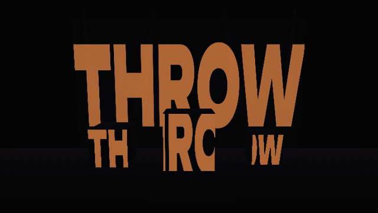

# throw

[](https://github.com/iliev-blnk/throw/actions/workflows/ci.yml)

Live visuals, projection mapping and light sync for small venues. It runs in a browser on one
laptop, with no internet connection needed.



[30 s demo with sound (previs)](media/throw-previs.mp4) ·
[program output](media/throw-program.mp4) ·
**[open the demo in your browser →](https://iliev-blnk.github.io/throw/previs.html?demo)** ·
[operator page](https://iliev-blnk.github.io/throw/)

- **Two decks** of sound-reactive scenes (light shafts through a word or logo, scan lines, a
  Hilbert curve, smoke, giant type, a dot grid, your own video or image, flat colour), crossfader,
  palette, hue, brightness, strobe, blackout.
- **Audio** from a microphone or the mixer's record-out: band meters, auto BPM, tap tempo, beat 1.
- **Projection mapping** onto any number of projectors. Each output window holds surfaces; each
  surface takes a slice of the picture and pins it to four corners, which you drag on the laptop
  or directly on the wall. Test card per output. Throw-distance calculator.
- **Lights over Art-Net**: RGB, RGBW and dimmer fixtures take the colour of the picture under them
  or chase on the beat; moving heads run beat-synced circle, figure-8, sweep and fan patterns.
  Finds Art-Net nodes on the network. A visualiser and DMX monitor work with no hardware.
- **Looks**: store up to 16, recall them on the beat with a 0–8 beat transition, or let autopilot
  change them every 4, 8 or 16 bars.
- **Phone remote**: scan a QR code and run scenes, crossfader, blackout, strobe, tap and looks
  from your phone ([pagepad](https://github.com/iliev-blnk/pagepad)).
- **3D previs**: the mapped wall, boxes and moving-head beams in a virtual room, so you can build
  the show before you are in the venue.
- **Show files**: export and import the whole show as one JSON file. Record the preview to video.

## Quickstart

Node 20+ and pnpm.

```sh
git clone https://github.com/iliev-blnk/throw && cd throw
pnpm install
pnpm start
```

`pnpm start` builds the app, starts the server on port 7700 and opens the operator page. The
terminal prints the network address for phones (`http://192.168.…:7700`).

```
throw [--port 7700] [--host 0.0.0.0] [--artnet 2.255.255.255] [--open]
```

`--artnet` is where DMX goes: a node's IP, a broadcast address (`2.255.255.255` is the Art-Net
default, `255.255.255.255` for most home networks), or `127.0.0.1` for software on the same
laptop such as ChamSys MagicQ or QLC+.

The [hosted copy](https://iliev-blnk.github.io/throw/) works without the server: visuals,
mapping, previs and the light visualiser run, Art-Net and the phone remote do not.

## Running a show

1. **Audio**: pick the input in the audio tab; a line from the mixer beats the laptop mic. If auto
   BPM is wrong, tap Space on four beats and press Enter on a downbeat.
2. **Outputs**: open one output window per projector, drag it to the projector's screen and press
   F. Turn on the test card, then select a surface in the outputs tab and drag its corners on the
   wall until the grid lines up. Arrows nudge 1 px, Shift+arrows 10 px.
3. **Lights**: patch fixtures in the lights tab (universe, address, mode). Check the DMX monitor
   before you send to real fixtures.
4. **Looks**: build a look, store it in a slot, recall with 1–9. Autopilot runs the night when you
   step away.
5. **Export the show** from the show tab before you close the laptop.

`docs/venue-checklist.md` is a printable checklist for load-in, line-check and the show itself.

| Key | |
|---|---|
| Space | tap tempo |
| Enter | this is beat 1 |
| 1–9 | recall look |
| B | blackout on/off |
| Esc | panic: blackout and zero on every DMX channel, moving heads included, until B |
| F | fullscreen (output window) |

## Safety

Strobe is capped at 10 Hz by default (show tab, hard maximum 15 Hz) and the cap applies to video
and DMX. Flashing faster than 3 Hz can trigger seizures in people with photosensitive epilepsy:
keep the cap at 3 Hz unless the venue posts a strobe warning. Blackout and panic act on video and
DMX at once.

## How it works

Every window renders the picture itself. Scenes are stateless fragment shaders, so a frame is a
pure function of the show, the time, the beat and the audio features. The operator sends those
over a `BroadcastChannel` and every output window stays in lock-step without streaming video.
Mapping is one full-screen pass per surface that applies the inverse homography of its four
corners. The audio analyser (FFT, three bands, spectral-flux onsets, autocorrelation tempo) is
plain TypeScript, shared by the live input and the offline renderer.

The Node server serves the app, relays the phone remote and turns WebSocket DMX frames into
ArtDMX packets over UDP (port 6454), with ArtPoll discovery.

The demo media is rendered frame-exact with [pagereel](https://github.com/iliev-blnk/pagereel)
from `render.html` and `previs.html`, driven by an analysed synthesised track:
`bash demo/render.sh`. `demo/demo-show.json` is the demo show; import it in the show tab.

```sh
pnpm check       # lint, typecheck, unit tests
pnpm test:e2e    # browser tests against the real server (system Chromium)
pnpm dev         # Vite dev server, without Art-Net or the remote
```

## Limits

- Tested on Chromium-based browsers (Chrome, Chromium, Edge) only.
- Four-corner pins and feathered edges. No mesh warps or edge blending between overlapping
  projectors.
- Art-Net only: no sACN, MIDI, NDI or timecode.
- Output windows must run on the same computer as the operator page.
- Recording captures the preview without sound.

## License

MIT. Fonts: Unbounded and IBM Plex Mono, SIL Open Font License (`web/fonts`).
